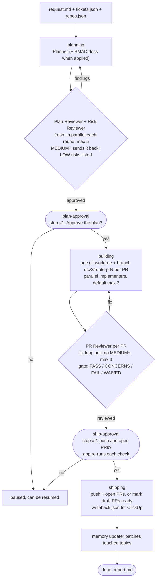

# DCTerminalv2

DCTerminalv2 is a macOS desktop app for running [Claude Code](https://docs.claude.com/en/docs/claude-code) in terminal tabs. Each window uses one Claude account, and two windows may use the same one. It is built with Tauri 2: a Rust backend in `src-tauri/` and a React 19 + xterm.js UI in `src/`. The app ships with `dcv2`, a Claude Code plugin (`plugin/`). Its main feature is the **Eagle-Eye run**: a single Claude session that plans a change, waits for your approval, builds each PR in its own git worktree with parallel sub-agents, reviews them, and asks again before it opens the PRs. The plugin also has standalone role skills, codebase memory and a safety guard. The app adds ClickUp ticket intake, session observation and phone notifications.

## Features

**Terminal app**

- Tabs that run Claude or a plain shell, with up to two split panes per tab (Cmd+D / Cmd+Shift+D), terminal search and clickable links.
- One Claude account per window, picked when the window opens. Claude accounts are managed in Settings.
- A start screen with Eagle-Eye and one tile per role, recent folders, a per-repo "Worktree setup" (setup command, git-ignored files to copy) and a codebase memory panel.
- Command palette (Cmd+K), File › Recently Closed, a Runs view (search by title, folder or ticket id, filter by stage) and an Active runs popover in the status bar.
- Usage: Claude's 5-hour and 7-day limits are read through the status line the app sets, and each tab's token usage comes from its session log.

**Eagle-Eye runs**

- A run panel beside the run tab. It shows the stage, approval stops, per-PR progress, review gates, check results, draft/ready badges, PR and review-comment links, and a cost and time estimate per stage and agent (at API list prices).
- Review mode: either local, or "Review on GitHub", where draft PRs open after the first build and every review round is posted as a PR comment.
- Optional BMAD planning (Auto / On / Off). It uses vendored [BMAD-METHOD](https://github.com/bmad-code-org/BMAD-METHOD) skills for spec, architecture, PRD and UX documents. Every story must cite the spec items it covers.
- The app re-runs each PR's check itself before the ship stop. A PR shows green only when its review gate passes and that check passes.
- Watchdog ("No progress for N min", with Nudge and Resume), "Waiting for you" reminders, a context meter, and a "While you were away" summary when you come back to a run tab.
- AFK use: the run can ask the app for a fixed set of actions (`recheck`, `cleanup`, `tickets`, `selftest`) through typed request files instead of handing you shell commands.
- Merged-run cleanup (on by default). Once a run's PRs are merged on GitHub, the app removes their worktrees and branches. It never force-deletes.
- GitHub CI and merge state per PR, read-only through `gh`.

**ClickUp**

- Intake: paste task, list or epic links or ids. The tickets are frozen into the run's `tickets.json` at Start, and the app can flag tickets that changed since then.
- Write-back: comment and status drafts are written at ship time. Comments are posted from the run panel after one click (optional, off by default) and secret-scanned first. Statuses stay manual ticks. Tokens live in the macOS keychain.

**Attention and notifications**

- Per-tab activity states (working / waiting / needs you) come from Claude Code hooks, through a small forwarder binary, `dcv2-hook`.
- In-app notices, macOS notifications, a dock badge and dock bounce, each with its own switch in Settings › Notifications.
- Phone push through ntfy, Pushover or a webhook. A push carries only the run id and the event kind. The push secrets are kept in the keychain.

**The `dcv2` plugin** (loaded per launch with `--plugin-dir`; nothing is installed into `~/.claude*`)

- `/dcv2:eagle-eye`: the orchestrator.
- Standalone roles: `/dcv2:planner`, `/dcv2:plan-reviewer`, `/dcv2:risk-reviewer`, `/dcv2:developer`, `/dcv2:pr-reviewer`, `/dcv2:recommendation`, `/dcv2:codebase-audit`, and `/dcv2:onboard` (which writes the codebase memory).
- Risk Reviewer: checks what could go wrong (data, security, compatibility, deployment and rollback, concurrency, blast radius). It reviews every Eagle-Eye plan round beside the Plan Reviewer, and the drafts of the standalone Planner, Codebase Audit and Recommendation; a MEDIUM or higher risk sends the work back (at most 5 rounds), LOW risks are only listed.
- Codebase memory (`plugin/scripts/memory.sh`): a per-repo index, topics and contracts, plus a workspace file for a folder of repos. All writes go through `memory.sh`, which rejects anything that looks like a secret. Staleness is tracked against git.
- Safety guard (`plugin/scripts/guard.sh`, a PreToolUse hook). Sub-agents stay inside their worktrees and the run folder, nothing is pushed before the ship approval, and run state files are written only by `state.sh`.
- Stop hook (`plugin/scripts/stop-check.sh`): an Implementer cannot finish while the repo check fails.

## How an Eagle-Eye run works

The app creates a run folder (`request.md`, plus `tickets.json` and `repos.json` when they apply) and launches `claude` with `DCV2_RUN_DIR` set. The skill records its progress in `status.json`, and the app watches that file. The stages are the ones defined in [docs/run-folder.md](docs/run-folder.md).



A PR that depends on another one starts only when its dependency has been reviewed clean. A run that stops partway can be resumed with `/dcv2:eagle-eye resume run=<run dir>`. A run with an unrecoverable error ends at `failed`, which also writes `report.md`.

## Requirements

- **macOS**. `install.sh` refuses to run on any other OS, and the bundle targets macOS 10.15 or later.
- **Claude Code CLI** (`claude`). The app checks its version, shows a banner when it is outside the tested range, and offers a one-click self-test.
- **git**: runs use worktrees and branches.
- **Node.js and npm**: for the UI build. BMAD planning also needs Node 18 or later at run time.
- **Rust toolchain** (stable, with `clippy` and `rustfmt`, pinned in `rust-toolchain.toml`).
- **python3**: the plugin scripts (`guard.sh`, `state.sh`, `memory.sh`, `stop-check.sh`) use it. The unit tests run on python3 3.9+, the macOS system python3 included. Without a working python3, the guard blocks the run's tool calls.
- **GitHub CLI `gh`** (optional): needed to open PRs, for GitHub review mode, for PR CI and merge status in the app, and for merged-run cleanup. Runs in repos with no git remote stay `local-only`.

## Install

```sh
./install.sh            # build, then install
./install.sh --no-build # install the last build
```

`install.sh` does the following:

1. Runs `npm ci` and `npx tauri build --bundles app`, then builds the `dcv2-hook` forwarder in release mode.
2. Checks that the bundle contains the plugin. If `dcv2-hook` is missing from the bundle, it copies it in (it refuses a forwarder older than the app binary) and re-signs the bundle ad hoc.
3. Refuses to install while any DCTerminalv2 app is running, from any folder: quit it with Cmd+Q and run the script again.
4. Copies the app to `/Applications`, or to `~/Applications` when `/Applications` is not writable. The old copy is kept until the new one is fully in place, and is restored if the copy fails.
5. Removes the quarantine attribute. This is a local install without notarization.

For a DMG, run `npm run release:mac`.

## Development

```sh
npm install
cargo build --manifest-path src-tauri/Cargo.toml   # once: builds the dcv2-hook forwarder
npm run dev:app                                      # tauri dev
```

- `tauri dev` builds only the app binary. Without `dcv2-hook` in `src-tauri/target/debug/`, tabs simply have no hook state (activity dots, attention).
- Debug builds keep their data in a separate folder, `~/Library/Application Support/com.jtfrancisco.dcterminalv2.dev`, so they never share state with the installed app. They also load the plugin from the repo's `plugin/` instead of the bundled copy. `DCTV2_PLUGIN_DIR` overrides the plugin folder.
- Release builds offer File › "Import from dev app…" to bring over windows, tabs, adopted runs and memory from the dev data folder. The import is refused while the dev app is running.
- The plugin also works from a plain terminal, for example `claude --plugin-dir plugin "/dcv2:planner <request>"`.

## Checks

There is no hosted CI. `npm run check` (`scripts/local-check.mjs`) is the gate for every change. It runs these steps in order:

1. Verifies that the release version matches in `package.json`, `src-tauri/tauri.conf.json` and `src-tauri/Cargo.toml`.
2. `cargo fmt --check`, `cargo clippy --all-targets -- -D warnings`, `cargo test`.
3. `npm test` (Vitest), then `npm run build` (`tsc` + `vite build`).
4. The plugin's hermetic bash suites, which make no Claude calls: `guard`, `state`, `memory`, `github`, `stop_check` and `plugin` (`scripts/skill-e2e/<name>_test.sh`).

The live plugin tests under `scripts/skill-e2e/` call Claude with the current account and are never part of the gate:

| Script | What it runs |
|---|---|
| `run.sh` | A full Eagle-Eye run on two toy repos, then a halt after PR1 and a resume |
| `golden.sh [multi dep fix]` | Three toy workspaces run in parallel, launched the way the app launches them. Run it before every release |
| `standalone.sh [roles...]` | Each standalone skill loads and replies, and read-only roles leave the repo untouched |
| `bmad_spike.sh` | BMAD planning spike |

## Repository layout

| Path | Contents |
|---|---|
| `src/` | React UI: `components/` (tabs, start screen, run panel, settings, palette), `run/`, `clickup/`, `usage/`, `terminal/` |
| `src-tauri/src/` | Rust backend: `pty/`, `run/` (launch, checks, cleanup, requests, GitHub), `observe/` (hooks, session logs, cost, attention, notifications, push), `clickup/`, `store/`, `provider/` |
| `src-tauri/src/bin/dcv2-hook.rs` | Hook forwarder: sends a minimal event to the app's local listener |
| `plugin/` | The `dcv2` plugin: `skills/`, `agents/`, `roles/` (one guidance file per role), `scripts/`, `hooks/`, `launch/settings.json` |
| `plugin/bmad/` | Vendored BMAD-METHOD skills and their Node runtime (MIT, see `plugin/bmad/NOTICE.md`) |
| `scripts/` | `local-check.mjs`, BMAD vendoring and patch scripts, and `skill-e2e/` plugin tests |
| `docs/` | Contracts between the app and the plugin, and dated plans |
| `install.sh` | Build and install into `/Applications` |

## Docs

- [docs/launch.md](docs/launch.md): how the app launches Claude with the plugin (environment, `--settings`, memory prompt), and how observability, attention and import from the dev app are built.
- [docs/run-folder.md](docs/run-folder.md): the run folder contract, covering inputs, `status.json` stages, review and BMAD modes, write-back, gates, AFK requests, cleanup and run-safety rules.
- [docs/skills.md](docs/skills.md): the `dcv2` plugin, covering Eagle-Eye, the standalone roles, codebase memory, the guard and the tests.
- [docs/plans/](docs/plans/): the dated implementation plans behind each milestone.
