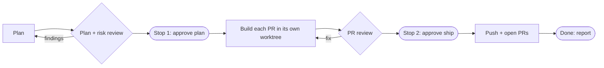

# DCTerminalv2

A macOS and Windows terminal app for [Claude Code](https://docs.claude.com/en/docs/claude-code). Open Claude in tabs, one Claude account per window, and let **Eagle-Eye** plan, build, review and ship a change for you, asking before anything leaves your machine.

Built with Tauri 2 (Rust in `src-tauri/`, React + xterm.js in `src/`) and the bundled `dcv2` Claude Code plugin (`plugin/`).

## What you get

| | |
|---|---|
| **Terminal** | Tabs and split panes, search, clickable links and file paths, command palette (Cmd+K, Ctrl+Shift+K on Windows), prompt scratchpad |
| **Eagle-Eye runs** | Plan → you approve → parallel builds in git worktrees → review → you approve → PRs opened |
| **Run panel** | Stage, per-PR progress, checks, review gates, cost and time, timeline, rendered plan and reviews |
| **ClickUp** | Paste ticket or epic links to start a run; post comments back with one click |
| **Notifications** | Per-tab "needs you" state, desktop notifications, dock badge (macOS), phone push (ntfy, Pushover, webhook) |
| **Role skills** | `/dcv2:planner`, `/dcv2:developer`, `/dcv2:pr-reviewer`, `/dcv2:codebase-audit` and more, each usable on its own |
| **Safety** | A guard keeps agents inside their worktree, nothing is pushed before your approval, secrets stay in the keychain |

## Requirements

**macOS**
- macOS 10.15 or later (`install.sh` refuses other systems)
- **Claude Code CLI** (`claude`), **git**, **Node.js and npm** (Node 18+ for BMAD planning)
- **Rust** stable, with `clippy` and `rustfmt` (pinned in `rust-toolchain.toml`)
- **python3** 3.9+ (the macOS system one is fine)

**Windows 10 / 11**
- **Git for Windows** (the app and the plugin run their scripts with its Git Bash)
- **Python 3.8+** (`python3`, `python` or `py -3` on the PATH; the Microsoft Store stub does not count)
- **Claude Code CLI** (`claude`), **Node.js and npm**, and **Rust** stable with the MSVC or GNU target to build from source

**Both:** the **GitHub CLI `gh`** is optional, for opening PRs, GitHub review mode, CI status and merged-run cleanup.

## Install

```sh
git clone https://github.com/jtfrancisco0121/DCTerminalv2.git
cd DCTerminalv2
./install.sh            # build, then install
./install.sh --no-build # install the last build
```

What `install.sh` does:

1. Runs `npm ci`, builds the app (`npx tauri build --bundles app`) and the `dcv2-hook` forwarder.
2. Checks the bundle has the plugin and the forwarder, and re-signs it ad hoc if needed.
3. Refuses while DCTerminalv2 is running. Quit it with **Cmd+Q** first.
4. Copies the app to `/Applications` (or `~/Applications`), keeping the old copy until the new one is in place.
5. Removes the quarantine flag (local install, not notarized).

For a DMG, run `npm run release:mac`.

### Windows

There is no prebuilt download: `install.ps1` builds the app from source on your PC, then installs it for your user only (no admin rights needed for the install itself).

**1. Install the tools** (once). In PowerShell, with [winget](https://learn.microsoft.com/windows/package-manager/winget/):

```powershell
winget install --id Git.Git -e                 # Git for Windows (gives Git Bash)
winget install --id Python.Python.3.12 -e      # Python 3.8+ (not the Microsoft Store stub)
winget install --id OpenJS.NodeJS.LTS -e       # Node.js + npm
winget install --id Rustlang.Rustup -e         # Rust (stable, MSVC target by default)
winget install --id Microsoft.VisualStudio.2022.BuildTools -e --override "--wait --passive --add Microsoft.VisualStudio.Workload.VCTools --includeRecommended"
winget install --id GitHub.cli -e              # optional: PRs, CI status, cleanup
```

The Build Tools line adds the C++ compiler and Windows SDK that Rust's MSVC target needs. Then **open a new PowerShell window** (so the new PATH applies) and install Claude Code and sign in:

```powershell
npm install -g @anthropic-ai/claude-code
claude          # sign in once, then exit
```

**2. Check them.** Each of these should print a version:

```powershell
git --version; node --version; npm --version; cargo --version; claude --version
python --version   # or: py -3 --version
```

If `python` opens the Microsoft Store, turn off the `python.exe` / `python3.exe` aliases in **Settings → Apps → Advanced app settings → App execution aliases**, then try again.

**3. Build and install:**

```powershell
git clone https://github.com/jtfrancisco0121/DCTerminalv2.git
cd DCTerminalv2
powershell -ExecutionPolicy Bypass -File install.ps1
```

What `install.ps1` does:

1. Refuses non-Windows systems, and refuses while DCTerminalv2 is running (close all its windows first).
2. Checks `node`, `npm` and `cargo` are on the PATH.
3. Runs `npm ci`, then `npm run release:win`: builds the app and an NSIS installer that also carries `dcv2-hook.exe` (the hook forwarder that gives tabs their live state), and fails if the forwarder is missing. The first build takes several minutes.
4. Runs the installer silently for the current user (into `%LOCALAPPDATA%\DCTerminalv2`).

**4. Start it** from the Start menu (**DCTerminalv2**). The installer is **unsigned**: if Windows SmartScreen says "Windows protected your PC", choose **More info**, then **Run anyway**. App data (settings, runs, memory) lives in `%APPDATA%\com.jtfrancisco.dcterminalv2`.

**Update:** close the app, then in the repo run `git pull` and `powershell -ExecutionPolicy Bypass -File install.ps1` again. **Uninstall:** **Settings → Apps → Installed apps → DCTerminalv2 → Uninstall** (your app data folder is kept unless you tick the uninstaller's option to delete it).

**If something is off:**

| You see | Do |
|---|---|
| "Git Bash not found. Install Git for Windows or set CLAUDE_CODE_GIT_BASH_PATH." | Install Git for Windows, or set the user environment variable `CLAUDE_CODE_GIT_BASH_PATH` to your `bash.exe` (e.g. `C:\Program Files\Git\bin\bash.exe`), then restart the app. The app never uses WSL's `bash.exe`. |
| "Blocked by the dcv2 guard … install Python 3.8+ (tried python3, python, py -3)" | Python is missing or only the Store stub is there: install Python (step 1) and turn off the Store aliases (step 2). |
| A repo check says "ran with cmd /C (Git Bash not found)" | Same fix as the Git Bash line: checks should run in Git Bash. |
| `npm run release:win` fails with a linker or `link.exe` error | The Visual Studio Build Tools C++ workload is missing (step 1). |

Known limits on Windows: no dock badge and no native menu bar (shortcuts are `Ctrl+Shift+<key>`, e.g. **Ctrl+Shift+K** for the command palette), and the installer is unsigned.

## Using it

1. Open **DCTerminalv2** from Applications (macOS) or the Start menu (Windows).
2. Pick the Claude account for the window. Add accounts in **Settings**.
3. On the start screen, choose a folder, then:
   - **Eagle-Eye** to start a run: describe the change, or paste ClickUp links.
   - A **role tile** (Planner, Developer, PR Reviewer, …) for a single task.
   - A plain **Claude** or **shell** tab.
4. In a run, answer in the run's tab at the two stops: **approve the plan**, then **approve shipping**.
5. Find past and active runs in the **Runs** view, or the status bar's Active runs.

### How a run flows



A stopped run can be resumed. Details are in [docs/run-folder.md](docs/run-folder.md).

## Development

```sh
npm install
cargo build --manifest-path src-tauri/Cargo.toml   # once: builds dcv2-hook
npm run dev:app                                      # tauri dev
```

- Debug builds use their own data folder (`com.jtfrancisco.dcterminalv2.dev`) and the repo's `plugin/`.
- The plugin also works in a plain terminal: `claude --plugin-dir plugin "/dcv2:planner <request>"`.
- **The gate:** `npm run check` runs rustfmt, clippy, cargo tests, Vitest, the build and the plugin test suites. There is no hosted CI. On a Mac, `brew install mingw-w64` adds a step that compiles every Windows-only branch (`cargo clippy --target x86_64-pc-windows-gnu`); without it the gate prints `skip: Windows cross-clippy (brew install mingw-w64)` and carries on. On Windows the gate runs the plugin suites under Git Bash.
- Live plugin tests that call Claude live in `scripts/skill-e2e/` (`run.sh`, `golden.sh`, `standalone.sh`, `bmad_spike.sh`).

## Repository layout

| Path | Contents |
|---|---|
| `src/` | React UI |
| `src-tauri/src/` | Rust backend: terminals, runs, observation, ClickUp, storage |
| `plugin/` | The `dcv2` plugin: skills, agents, roles, scripts, hooks, vendored BMAD |
| `scripts/` | `local-check.mjs` (the gate), plugin tests, `verify-win-bundle.mjs` |
| `install.sh`, `install.ps1` | The macOS and Windows installers |
| `docs/` | App ↔ plugin contracts and dated plans |

## Docs

- [docs/launch.md](docs/launch.md): how the app launches Claude and observes it
- [docs/run-folder.md](docs/run-folder.md): the run folder contract and run rules
- [docs/skills.md](docs/skills.md): the plugin, roles, memory and guard
- [docs/plans/](docs/plans/): dated design plans
