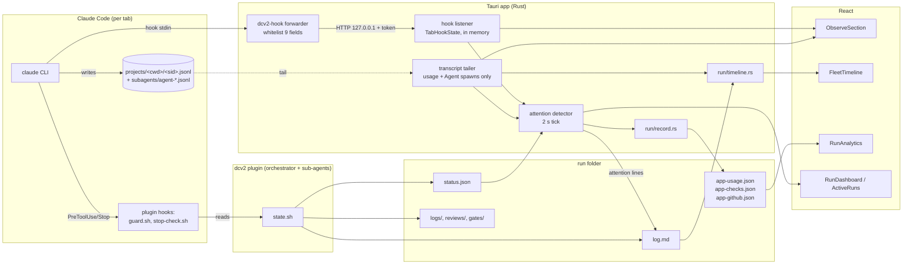
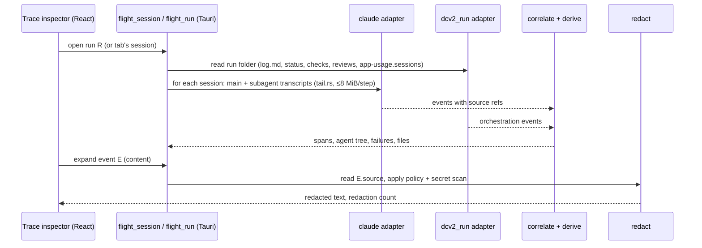

# AgentFlight: architectural discovery

Status: discovery only, nothing built. Base commit `78f1815`. 2026-11-04.

**Scope (JT, 2026-11-04):** version 1 covers **Claude Code only**, on the existing Claude Code sign-in and subscription.
- No API keys, no separate API billing, no other LLM providers.
- AgentFlight itself makes **no model calls**: every analysis is deterministic code over hooks and session files.
- The design stays open to other providers (a provider field and an internal adapter seam), but none is built.

## 1. Summary

DCTerminalv2 already has more observability than the brief assumes, but almost all of it is **live state** (what is happening now) or **run-level totals** (what a finished run cost). What it lacks is the **event record** in between: per-tool-call, per-file, per-failure history.

The most important finding is that this record is not missing from the disk. Claude Code's session JSONL transcripts already hold every tool call with its input, its result and its error, linked as a tree (`uuid`/`parentUuid`), with sub-agent transcripts beside them. Codex writes rollout JSONL and OpenCode writes SQLite. The app already tails the Claude ones (`observe/transcript.rs`), but keeps only usage and Agent/Task spawns and throws the rest away.

So AgentFlight's first job is **not to record**. It is to **read, normalize, correlate and explain** what agents already record, and to join it with what only DCTerminal knows: the run, stage, PR, worktree, check results, reviews, approvals and guard blocks. Recording only starts where the provider logs fall short (git state, guard decisions, state transitions) or where they expire (Claude purges transcripts after `cleanupPeriodDays`, 30 by default).

This changes several parts of the brief:

| Brief says | Recommendation | Why |
|---|---|---|
| A recorder or SDK that captures prompts, responses and tool I/O | An **indexer over provider-native logs**, plus thin capture only for gaps | The content is already on disk. Copying it doubles the privacy surface and the storage for no new information. |
| SQLite from the start | **No new storage in M1**: read on demand. SQLite in M3, once cross-run queries exist. | M1's questions are about one session, which a transcript read answers. The decision log rules out aggregate backend commands for a reason that only stops holding once session logs are indexed (§9). |
| OpenTelemetry as the core model | Use OTel at the **edges** (export, later ingest), not as the internal schema | GenAI semconv is still at Development status and has no concept of file changes, git, checks or approvals. Claude Code's own trace spans (beta) don't follow it either. |
| A separate AgentFlight Studio | **Studio = panels inside the app** first; extraction later | A second UI before one adapter works is speculative. |
| Separate packages or processes | **One Rust module** (`src-tauri/src/flight/`) with an enforced dependency boundary, extracted to a crate once the Claude and run-folder adapters have settled the schema | The `observe/forward.rs` precedent (std + serde_json, no `crate::`) shows this boundary works here. |
| Compete as a general observability tool | Specialize in what **coding agents** do that LLM tools don't model | Langfuse, Phoenix and Laminar model LLM and tool spans only. None of them treats diffs, git, tests, permission decisions or multi-agent role/PR structure as first-class. That is the gap worth filling. Export to them rather than rebuilding their generic LLM views. |
| Session replay | Split three ways and label honestly (§8) | Replaying model reasoning deterministically is impossible. Re-executing tools has side effects. Scrubbing through recorded events is cheap and safe. |

## 2. Existing functionality inventory

Legend: ✅ fully implemented, 🟡 partial, ❌ missing, 🔧 needs refactoring to be reused.

### Live session observability (`src-tauri/src/observe/`)

| Capability | State | Where / notes |
|---|---|---|
| Hook capture of 12 Claude events (SessionStart … SessionEnd, incl. Pre/PostToolUse, PostToolUseFailure, Subagent*, StopFailure, PermissionRequest) | ✅ live, ❌ history | `observe/hooks.rs:455` `EVENTS`; forwarder `bin/dcv2-hook.rs` → `observe/forward.rs`. HTTP to 127.0.0.1 with a per-launch token, constant-time compare, size and connection limits. |
| Hook payload content | ❌ by design | `forward::reduce` (`forward.rs:33`) keeps 9 id/name fields at ≤200 chars and drops the prompt, tool_input, tool_response, last message, cwd and transcript_path. This is a deliberate privacy line worth keeping (§7). |
| Per-tab activity state machine (working / waiting / needs-you), running tools, sub-agent count | ✅ in memory only | `TabHookState::apply` (`hooks.rs:89`). It **ignores** tool_name, agent_id, agent_type and reason, which already arrive. |
| Transcript tailing (main + `subagents/agent-<id>.jsonl` + meta) | ✅ 🔧 | `observe/tail.rs` (byte offsets, partial line held, restart on shrink); `observe/transcript.rs:215` `take_line` parses only usage, Agent/Task tool_use and their results. The tailer is reusable as is; the parser needs to become an adapter. |
| Orchestrator → sub-agent linkage | ✅ | Agent `tool_use.id` ↔ `toolUseResult.agentId` (`transcript.rs:310`); `SubagentInfo`. |
| Sub-agent → PR linkage | ❌ | Only stop-check.sh guesses it (`stop-check.sh:68-82`) and saves nothing. Lanes and SubagentInfo carry agentType and a free-text description only. |
| Tokens, cost estimate, context meter | ✅ | `observe/price.rs` (one table, first fragment match), `SessionTracker::summary`, `CONTEXT_WARN`. |
| Per-stage and per-agent cost and active minutes | ✅ 🔧 | `transcript.rs:395` (5 min gap rule) and `run/record.rs:152` (30 min cap) use **two different idle rules**. |
| Rate-limit usage | ✅ | `status_line.rs` / `usage.rs`. The statusLine JSON's own cost and model are dropped. |
| Stall watchdog, waiting-for-you, nudge | ✅ computed, not stored | `observe/watchdog.rs`. |
| Attention events (13 kinds), OS notifications, phone push | ✅ edge-triggered, in memory | `observe/attention.rs:52`, `notify.rs`, `push.rs`. Persisted only as `attention <kind>` lines in log.md. |
| Claude Code version pinning + self-test | ✅ | `observe/version.rs`, fixtures `src-tauri/src/fixtures/claude-2.1.287/`. |
| Provider abstraction | ❌ | `provider/mod.rs:1` "D3: Claude only". `ClaudeProvider` is a concrete struct; there is no trait. |

### Run-level history (`src-tauri/src/run/`, plugin)

| Capability | State | Where / notes |
|---|---|---|
| Run folder (plan, status, log, reviews, reports, logs, gates) | ✅ | Contract `docs/run-folder.md`. |
| Run log (`log.md`, `<UTC> <stage> <text>`) | ✅ 🟡 | Free text. Retries exist only as `retried` strings; `report.md` counts them by substring. |
| State transition history | ❌ | `state.sh` `write_status` rewrites status.json whole; no transition is kept except what the orchestrator chooses to log. |
| Run record (sessions, tokens, cost, minutes by stage, wait, span, outcome, PR URLs) | ✅ | `run/record.rs` → `app-usage.json`, written at done/failed. |
| Agent lanes timeline (Gantt with stage bands and waits) | ✅ | `run/timeline.rs` `run_timeline` → `FleetTimeline.tsx`. Lanes have no PR id and no tool-level detail. |
| Cross-run analytics (cost, duration, wait share, trend) | ✅ | `src/run/analytics.ts` + `RunAnalytics.tsx`, pure TS over `runOverview` (decision 2026-11-01). |
| Check results | ✅ scattered | Skill: `status.json prs[].check` + `logs/<PR>-check.txt`; app re-run: `app-checks.json` + `logs/<PR>-app-check.txt`; Stop hook: `logs/<PR>-stop-check.txt` (last failure only, and not in log.md). |
| Reviews per round | ✅ | `reviews/PR<n>-round<n>.md`; `gates/PR<n>.yml` is overwritten each round. |
| Approvals (plan, ship) | ✅ | `status.json plan.approval{by,at}`, `shipApproval`, log lines. |
| GitHub CI / PR state | ✅ | `run/github.rs` → `app-github.json`. |
| Guard decisions | ❌ | `guard.sh` prints "Blocked by the dcv2 guard" to stderr and exits 2; nothing is logged. A block is visible only inside the transcript as a hook error. |
| File-change record | ❌ structured, 🟡 derivable | The implementer's `filesTouched` count, the report's file list, `state.sh scope` numstat on demand, `run/slop.rs` diff on demand. Edit/Write tool inputs in the transcript are the real record. |
| Per-tool-call record | ❌ | Only in Claude's transcript. |
| Session continuity across /clear, resume | 🟡 | `app-usage.json.sessions` (ordered list). A tab keeps only its current session (`remember_claude_session`). |
| Terminal scrollback | ❌ by design | In memory only (`src/terminal/buffer.ts`). |

### Redaction

| Capability | State | Where |
|---|---|---|
| Secret scanner (keys, tokens, JWT, URL passwords, `.env` lines) | ✅ 🔧 | `clickup/secret_scan.rs` (Rust) and `memory.sh` (Python), kept in sync by test `verdicts_match_memory_sh`. Today only ClickUp uses the Rust one. It should move to a shared module rather than be copied. |
| Redaction of observability data | n/a today | Not needed today because content is never captured (whitelist plus a parser that ignores content). It becomes mandatory the moment AgentFlight shows or exports content. |

### Doc drift found

`docs/launch.md:101` lists 11 hook events and 8 fields; the code registers 12 (`StopFailure` is missing from the doc) and keeps 9 fields (`tool_use_id` is missing). This should be fixed before the contract is extended.

## 3. Current observability architecture



**Where the information is lost:**

- The forwarder whitelist (intentional).
- `apply()` ignoring tool/agent names.
- `take_line` ignoring every tool other than Agent/Task.
- All hook and transcript state being in memory only.
- status.json overwrites.
- guard.sh writing no log.
- Claude's 30-day transcript purge.

## 4. Gaps against the AgentFlight vision

| Vision | Have | Gap | Size |
|---|---|---|---|
| A. Inspect one execution end to end | Live state, usage, sub-agent list | A normalized event stream from transcripts (tool calls, results, errors, file edits) and a UI for it | **Medium**: data on disk, parser and UI needed |
| B. Timeline incl. sub-agents, files, errors, approvals | Lanes per agent, stage bands, waits | Tool-level events inside lanes; approvals, checks, reviews and guard blocks as markers; lane → PR link | Medium |
| C. Failure investigation | Check logs, review files, `retried` lines, attention events | Failure detection over events (`is_error` results, PostToolUseFailure, StopFailure, guard blocks, failed checks); "what happened before"; repeated-failure detection; files affected | Medium; heuristics need labels |
| C. Diff a good vs bad run | Run-level cost and duration trend | Comparing two runs on structure (tools, failures, files, checks) | Needs a persistent index (M3) |
| D. Replay | Re-run checks at the worktree (R1) | Event scrubbing; re-running a check at a recorded commit; fork-from-point | See §8 |
| E. Multiple providers | Claude only, no trait | **Out of scope for v1.** Keep a `provider` field and one internal adapter seam | Deferred |
| F. Analytics and evaluation | Cost/duration/wait per run, pure TS | Retries, tool failure rate, check pass rate, per-role efficiency; a repeatable eval (same task, N runs) | M3 + M5 |
| Privacy controls | Content never captured | Capture policy, redaction at display/export, retention | Must ship with M1 |

## 5. Proposed module boundaries

```mermaid
flowchart TB
  subgraph flight["src-tauri/src/flight/ (AgentFlight core, no crate:: imports except through a narrow host trait)"]
    SCH[schema.rs<br/>Event, Span, Session, ContentRef]
    AD[adapters/<br/>claude.rs · dcv2_run.rs]
    COR[correlate.rs<br/>spans from start/end, agent tree,<br/>PR and stage attribution]
    DET[derive.rs<br/>failures, retries, files touched<br/>(labelled heuristics)]
    RED[redact.rs<br/>moved secret_scan + capture policy]
    IDX[index.rs<br/>M3: SQLite]
    EXP[export.rs<br/>M4: OTLP JSON, bundle]
  end
  subgraph host["DCTerminal (stays)"]
    OBS[observe/ live state, attention, watchdog]
    RUN[run/ orchestration, records, checks]
    CMD[commands: flight_session, flight_run]
  end
  subgraph ui["src/flight/ (Studio as panels)"]
    INS[Trace inspector]
    FAIL[Failure view]
    CMP[Compare (M3)]
  end
  AD --> COR --> DET --> CMD
  RED --> CMD
  OBS -. reuses tailer .-> AD
  RUN -. run folder paths .-> AD
  CMD --> INS & FAIL & CMP
  IDX -.-> CMD
```

- **One Rust module, not a crate yet, not a process.** The boundary is enforced the way `forward.rs` already is: `flight/` uses std, serde and regex and takes paths and readers as inputs. A source-scan test can reject `crate::` imports outside a small `host.rs`, like the existing `platform::quiet_command` source scan. It becomes a workspace crate (`agentflight-core`) once the schema has held steady across a few Claude Code version bumps, and gets a CLI (`agentflight inspect <session>`) at the same time. That CLI is what makes it adoptable outside DCTerminal.
- **DCTerminal's run folder is an adapter too** (`dcv2_run.rs`). It turns log.md, status.json, app-checks.json, reviews, gates and requests into events. This keeps orchestration knowledge out of the core schema and shows that the "host platform" is just another source.
- **`observe/` keeps live state.** Stall detection, activity dots, attention and push stay where they are. AgentFlight is the after-the-fact and drill-down layer. The two share the tailer, the price table and the redactor; neither duplicates the other.
- **Move, don't copy:** `observe/tail.rs`, `observe/price.rs` and `clickup/secret_scan.rs` are generic. They move under `flight/` with re-exports, so ClickUp and observe keep compiling unchanged. The memory.sh parity test moves with the scanner.
- **The frontend follows existing rules:** inline SVG (decision 2026-11-01, no chart or icon library), tones through `src/run/words.ts`, overlays inside `.workspace-body` so terminals stay mounted.

## 6. Recommended event schema

The design rules are:

1. **Reference content, don't copy it.** Every event carries a `source` pointer (file, byte offset, line hash) to the provider's own record. Provider-specific detail is never lost because the raw line is always one read away, and content is copied only under an explicit retention policy.
2. **Spans are derived, events are facts.** Adapters emit point events. The correlator pairs start/end (tool_use ↔ tool_result by id) into spans.
3. **Every derived conclusion says how it was derived**, e.g. `"derived": "heuristic:same-tool-same-input-after-error"`, so the UI never presents a guess as a fact.

```jsonc
// flight Event, schema 1
{
  "schema": 1,
  "id": "ev_…",                       // stable: hash(source.file, source.offset)
  "trace": "r-20261101-025001-6036",   // run id, or "session:<sid>" outside runs
  "session": "6f1c…",                  // provider session id
  "agent": {                           // who acted
    "id": "a1b2…",                     // provider agent id; "main" for the root
    "parent": "main",
    "kind": "subagent",                // main | subagent
    "type": "dcv2:implementer",        // provider's agent type
    "role": "implementer",             // dcv2 role, when known
    "pr": "PR1"                        // when attributable (see M2)
  },
  "provider": { "name": "claude-code", "version": "2.1.287", "native": "assistant.tool_use" },
  "kind": "tool.start",                // enum below
  "at": "2026-11-01T02:51:04.120Z",
  "span": "tu_01…",                    // pairs start/end (tool_use_id, turn id, check id)
  "status": null,                      // ok | error | blocked | cancelled on *.end
  "name": "Bash",                      // tool name, check command id, stage name
  "attrs": {                           // small, safe, kind-specific fields
    "files": ["src/run/record.rs"],    // for edits: paths only
    "exit": 1
  },
  "usage": null,                       // { input, output, cacheWrite5m, cacheWrite1h, cacheRead, model, usd }
  "content": {                         // never inline by default
    "ref": { "file": "<config>/projects/…/6f1c….jsonl", "offset": 183204, "len": 912, "sha256": "…" },
    "policy": "metadata",              // metadata | redacted | full (what this event may show/export)
    "redactions": 0
  },
  "derived": null                      // e.g. "heuristic:retry-of ev_…"
}
```

**Cost on a subscription.** Subscription users pay no per-token bill, so dollars are shown only as an *API-equivalent estimate* (the existing `price.rs` table), clearly labelled. The primary usage measures are:
- tokens per agent, stage and tool;
- the share of the 5-hour and weekly windows a run consumed, from the existing statusLine `rate_limits` history (`usage.rs`).

**Kinds (closed core set, open `x.<provider>.*` extension):**

| Group | Kinds |
|---|---|
| Lifecycle | `session.start`, `session.end`, `turn.start` (user prompt), `turn.end` (Stop), `compact` |
| Model | `llm.call` (one per deduped assistant message, with usage) |
| Tools | `tool.start`, `tool.end`, `tool.blocked` (guard/permission), `permission.request`, `permission.decision` |
| Agents | `agent.spawn`, `agent.end` |
| Workspace | `file.change` (from edit tools, and git in M2), `git.commit`, `git.push` |
| Quality | `check.start`, `check.end` (skill, app, stop-check), `review.round`, `ci.state` |
| Orchestration (dcv2 adapter) | `stage.change`, `approval.wait`, `approval.decision`, `retry`, `attention` |
| Errors | `error` (StopFailure, API error, parse failure of our own) |

**OTel mapping (export only):**

- trace = `trace`.
- `agent.spawn`/`end` → `invoke_agent` span with `gen_ai.agent.id/name`.
- `tool.*` → `execute_tool {name}` with `gen_ai.tool.call.id` (arguments and result only when policy is `full`).
- `llm.call` → `chat` with `gen_ai.usage.*`.
- `gen_ai.conversation.id` = session.
- File, check and approval events go out as span events under an `agentflight.*` namespace.
- Pin to a semconv version in export code because the spec is still Development.

## 7. Integration architecture



- **M1 needs no new process, no new storage and no new capture.** It runs on demand, on worker threads, with paging. It caches parse results per (file, size, mtime) in memory, the same way `SessionTracker` is cached per tab.
- **Content is read lazily per event** through `content.ref`, so the list view never holds prompts or tool output.
- **Hook data stays metadata-only.** It contributes precise timing and `PostToolUseFailure`/`StopFailure`/`PermissionRequest` events for live sessions. For an M3 index, the listener would append the already-reduced payload to a per-session NDJSON; it is then still free of content.
- **Respect the existing rules:**
  - Stay out of the 2 s `list_runs` sweep (decision 2026-11-01).
  - Read run files only through `checked_run_dir`.
  - Git only through `run/git.rs`.
  - Child processes only via `platform::quiet_command`.
  - Lock order PtyRegistry → StateStore → SettingsStore.

## 8. Replay: what each kind can honestly promise

| Kind | What it does | Guarantee | Phase |
|---|---|---|---|
| **Event replay** | Scrub a recorded timeline, step through tool calls and their recorded results, view the file state after each edit (reconstructed from edit inputs plus the base commit) | Exactly what was recorded, no more | M2/M5 |
| **Check replay** | Re-run a recorded check command at a recorded commit in a scratch worktree (extends R1 `rerun_checks` + janitor rules) | Same code + same command; the environment can differ (deps, network, time) | M5 |
| **Session fork** | Start a new agent session from a point in an old one (Claude `--resume`; fork support to be verified per provider) | **None about model output.** A new execution that starts from the same context. | M5, opt-in |
| Tool re-execution | Re-run recorded Bash and other side-effecting calls | Not offered: pushes, network and deletes make it unsafe, and the guard exists to prevent exactly this | ❌ |

The UI must label these "recorded", "re-run" and "new execution", never "reproduce".

## 9. Security and privacy

- **Keep the current line.** The hook channel never carries content; this is the strongest property the app has today. AgentFlight adds content **display** from files the user's agent already wrote locally, not new capture.
- **Capture policy** (setting, per account, overridable per run in meta.json):
  - `metadata`, the default: names, ids, times, paths, exit codes and usage. Content is viewable on click, redacted.
  - `redacted`: may be indexed (M3) or exported after a secret scan.
  - `full`: export unredacted; requires an explicit per-export confirmation.
  - `off`: no AgentFlight reads for that account.
- **Redaction happens at the boundary:** before display, index and export, never on the source files. One scanner (moved `secret_scan.rs`), with the memory.sh parity test kept. Redaction is a regex filter and will miss things. The UI says so, and export defaults to `metadata`.
- **Retention:**
  - Claude purges transcripts after 30 days. For run sessions, M3 offers to snapshot redacted event content into `<run>/flight/` at run end, so a run stays inspectable. This is a new app-written file, so docs/run-folder.md changes first and guard.sh `PROTECTED` gets it.
  - Snapshots are deleted when the run is.
- **Untrusted input:** transcripts contain tool output from arbitrary repos and web pages. It must never be rendered as HTML or Markdown that executes, never be sent to a model without a framing, and never be followed as instructions (the same rule the app applies to requests and ticket text).
- **Export** (bundle or OTLP) is the only path off the machine. It is an explicit action with a preview of what leaves. OTLP endpoints default to localhost.
- **Paths:** source refs store `real_path()` values and compare with `ident()` on Windows (decision 2026-11-01).

## 10. Phased roadmap

**M0: hygiene (½ day).**
- Fix the launch.md drift (`StopFailure`, `tool_use_id`).
- Unify the two idle rules or document why they differ.
- Record this plan's decisions in `topics/decisions.md`.

**M1: Session Inspector (smallest useful milestone).**
- A Claude adapter turns the main and sub-agent transcripts into schema-1 events. Correlation pairs tool spans and builds the agent tree.
- Derived facts:
  - failures (`is_error` tool results, PostToolUseFailure-equivalents, StopFailure, guard blocks seen as hook errors in the transcript: on 2.1.287 a `type: "user"` line whose `tool_result` has `is_error: true` and content `PreToolUse:Bash hook error: [bash "<guard.sh>"]: Blocked by the dcv2 guard: <reason>`, with a top-level `toolDenialKind: "permission-rule"`; a plain failing command is `is_error: true` with `Exit code N` and no `toolDenialKind`; a failed API turn is an `assistant` line with `isApiErrorMessage: true`, an `error` kind and an optional `apiErrorStatus`);
  - "last N events before failure";
  - files touched (paths from Edit/Write/MultiEdit/NotebookEdit inputs);
  - repeated failures (same tool + normalized input, labelled heuristic).
- `flight_session` command (paged). A "Trace" panel reachable from ObserveSection and the FleetTimeline lanes, with an agent tree, an event list, a failure jump list and lazy, redacted content.
- No storage, no new capture, no plugin change.
- **Done when:** for a finished run, a user can answer "which tool call failed, what preceded it, was it retried, which files did this agent touch" without opening a terminal or a JSONL file.
- Tests: the existing `claude-2.1.287` fixtures, plus a sanitized fixture with a failing Bash call and a guard block.

**M2: run correlation.**
- The dcv2_run adapter merges stage changes, approvals, checks, reviews, CI and attention into the same timeline.
- Plugin changes (bash 3.2 safe, docs first):
  - guard.sh appends one line per block to `logs/guard.log` (rule id + tool name, no command text). The guard is a hot path, so append only.
  - stop-check.sh logs its result to log.md.
  - The orchestrator passes the PR id in the Agent `description` in a fixed form, so sub-agent → PR attribution is exact rather than heuristic.
  - State transitions get a `state.sh` log line per PR state change (status.json schema stays 1).

**M3: persistent index and compare.**
- SQLite (`rusqlite` with `bundled`, one dependency, no service) at `<app data>/flight.db`, holding events, spans and refs, no content by default.
- Built incrementally from (file, offset) watermarks by the existing background pass, not the 2 s sweep.
- Adds:
  - cross-run search ("all runs where `cargo test` failed in PR review");
  - compare two runs (stages, tools, failures, files, checks, cost);
  - the retention snapshot (§9).
- This **contradicts decision 2026-11-01 "no Rust aggregate/analytics command"**. That decision's reason was that runOverview reads small files and parses no session log; the index does parse session logs, so the reason no longer covers it. Existing run analytics stay in TS over `runOverview`, and only trace queries go to the index.

**M4: deeper Claude Code coverage and interop (no new provider).**
- More hook events, verified against the pinned Claude Code version and added to fixtures first: `PreCompact`/`PostCompact`, `PermissionDenied`, `PostToolBatch`, `FileChanged`, `WorktreeCreate`/`WorktreeRemove`, `PreModelSwitch`/`PostModelSwitch`. The forwarder whitelist grows only by ids and enum fields, never content.
- Optional local ingest of Claude Code's own OpenTelemetry (`CLAUDE_CODE_ENABLE_TELEMETRY`, OTLP to a 127.0.0.1 receiver in the app, content flags left off). It adds `api_request`/`api_error` events with durations. It works on the subscription and needs no API key. It is only worth building if M1–M3 show gaps that the transcript does not cover.
- OTLP/HTTP-JSON export with the GenAI semconv mapping, to a local tool such as Phoenix.
- The adapter seam stays internal, with one implementation. Other providers (Codex rollouts, OpenCode, Gemini CLI) are a later, separate decision; the research notes in §6 keep the schema compatible with them.

**M5: replay and evaluation.**
- Event scrubbing with reconstructed file state, and check replay at a commit (§8).
- An eval mode: run the same task N times through Claude Code on the user's own account (the way the version self-test already does), then compare completion, checks, retries, tool failures, tokens and time across runs and Claude models. Results are shown as distributions, not single runs.
- This is the only AgentFlight feature that spends subscription usage. It is opt-in, shows the run count first, and respects `run.usage_hold_percent`.

**M6: extraction.**
- `agentflight-core` crate + `agentflight` CLI (`index`, `inspect`, `export`) + schema docs + an adapter guide.
- Publish only once one consumer outside DCTerminal works (for example the CLI used on plain Claude Code sessions). Before calling the schema provider-independent, check it on paper against the Codex and OpenCode event shapes in the research notes; a schema shaped by one producer can freeze the wrong design.

## 11. Risks

| Area | Risk | Why | Care |
|---|---|---|---|
| Transcript format | Claude's JSONL is undocumented and changes | The app already pins `CLAUDE_MAX_TESTED` 2.1.287 and has fixtures | Tolerant parser; unknown lines become `x.claude.unknown` events with a source ref, never errors; extend the version self-test |
| Large sessions | Multi-MB transcripts, many sub-agents | `tail.rs` caps 8 MiB per step | Page results, parse on worker threads, cache by (file, size, mtime) |
| Privacy | The inspector makes secrets in tool output easy to see and copy | Content is plaintext on disk today, but nobody reads it | Redact before display; default `metadata`; no export without preview |
| Heuristics | Retry and failure detection mislabels | They are inferences | Every derived fact is labelled and links to its evidence |
| Scope creep | Becoming a generic LLM tracer | Competes with Langfuse/Phoenix on their ground | Coding-agent-specific views; export to them |
| Contracts | The run folder gains files (`logs/guard.log`, `flight/`) | Binding contract | docs/run-folder.md first; guard `PROTECTED`; schema stays 1 (additions only) |

## 12. Open questions for JT

1. Should the default capture policy be `metadata` (my recommendation), or should run sessions be `redacted` and snapshotted automatically?
2. Should M1's inspector cover every Claude tab (hooks are on for all tabs by default) or run tabs only?
