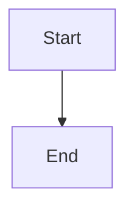

# Plan 

<iframe src="https://evil.example/"></iframe>

raw html block

[js link](javascript:alert(1))
[data link](data:text/html;base64,PHNjcmlwdD5hbGVydCgxKTwvc2NyaXB0Pg==)
[file link](file:///etc/passwd)
[web link](https://example.com/page)
[relative link](./other.md)
[anchor link](#details)

## Details

| a | b |
|---|---|
| 1 | <b onmouseover="x()">2</b> |
